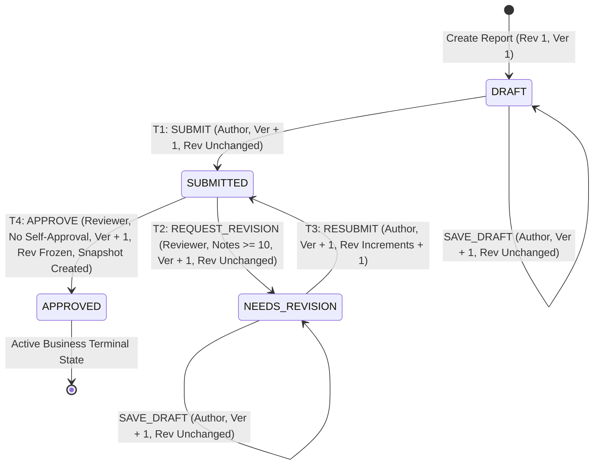
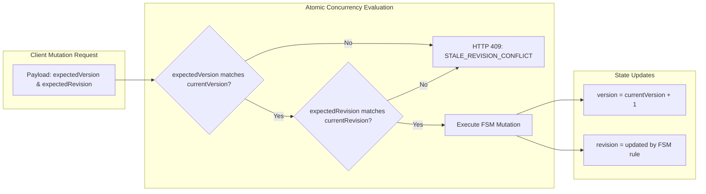

# ONEWILL ACADEMY — M4.2 WORKFLOW ARCHITECTURE SPECIFICATION (v1.0)
## Reconciled Report Lifecycle, Concurrency Engine, RBAC & API Layer

**Document ID:** ARCH-M4.2-001
**Status:** RECONCILED ARCHITECTURE DRAFT FOR OWNER REVIEW
**Version:** 1.0 (Reconciled from M4.2-A Proposal, M4.2-B Domain Engine, and M4.2-C Implementation)
**Authors:** Principal Software Architect, Firebase Security Architect, Senior TypeScript Engineer, QA Lead
**Repository:** `onewillacademyid/onewill-4table-dashboard`
**Target System:** Onewill Academy 4-Table Weekly Progress Reporting Dashboard
**Branch Baseline:** `feat/premium-ui-redesign` (HEAD: `060b595`)

---

## 1. Executive Summary & Historical Evolution

The Report Lifecycle & Review Governance Architecture evolved across three milestones:
1. **M4.2-A (Proposed Architecture):** Established the architectural blueprint, state diagrams, and Architecture Decision Records (ADRs). It proposed an 9-transition lifecycle including amendment (`/amend`) and cold-storage archiving (`ARCHIVED`).
2. **M4.2-B (Domain Engine & Validators):** Refined the core finite state machine into a pure, side-effect-free deterministic domain model focusing on the 4 canonical MVP transitions (T1–T4) plus draft saving. Amendments and direct status archiving were formally deferred.
3. **M4.2-C (Repository & Next.js API Layer):** Implemented server-authoritative optimistic concurrency (`version` sequence token vs `revision` business counter), atomic Firestore transactions, fail-closed dual-key feature gates (`REPORT_WORKFLOW_WRITES_ENABLED`), immutable version snapshots (`reports/{id}/versions/v{revision}`), and Next.js App Router route handlers.

This document serves as the single source of truth reconciling all three milestones.

---

## 2. Architecture Decision Records (ADRs)

### ADR-001: Retain `NEEDS_REVISION` as Canonical Report Status
- **Status:** ACCEPTED & IMPLEMENTED (M4.2-B, M4.2-C)
- **Decision:** Retain `NEEDS_REVISION` as the canonical `report.status` enum value. `REVISION_REQUESTED` is preserved strictly as the audit event action name (`audit_events[].action`) and revision history action name (`revisionsHistory[].action`).
- **Rationale:** Preserves complete backward compatibility with existing Firestore reports (`rep_2026_w41_team-operasional` and `rep_2026_w42_team-operasional`), existing UI components (`StatusBadge`), and database index definitions.

### ADR-002: Orthogonal `archiveStatus` vs Business Lifecycle `status`
- **Status:** ACCEPTED & IMPLEMENTED (M4.2-B, M4.2-C)
- **Decision:** Keep `report.status` (business state) completely orthogonal to `archiveStatus` (external storage pipeline).
  - Business status is frozen at `APPROVED`.
  - External storage archiving operates on `archiveStatus`: `'NOT_ARCHIVED' | 'QUEUED' | 'ARCHIVED' | 'FAILED'`.
- **Rationale:** High fault tolerance. A failure in external Google Drive export or quota exhaustion must NEVER revoke, stall, or invalidate a business-approved management report.

### ADR-003: Avoid a Persistent `IN_REVIEW` Locking State
- **Status:** ACCEPTED & IMPLEMENTED (M4.2-B, M4.2-C)
- **Decision:** Do NOT introduce an `IN_REVIEW` database status. Reports remain in `SUBMITTED` until an explicit review decision (`APPROVED` or `NEEDS_REVISION`) is committed.
- **Rationale:** Avoids distributed locking hazards where a manager opening a tab and walking away locks out other reviewers or leaves reports stranded. Concurrency is handled cleanly via optimistic version tokens and atomic transactions.

### ADR-004: Immutable Approval Snapshots in Subcollection
- **Status:** ACCEPTED & IMPLEMENTED (M4.2-B, M4.2-C)
- **Decision:** Store summary timeline metadata in `revisionsHistory[]` within the root document `reports/{id}`, and persist full immutable 4-table content snapshots in `reports/{id}/versions/v{revision}` upon each successful `APPROVE` transaction.
- **Enforcement:** Overwrites of existing snapshots are strictly rejected with `SNAPSHOT_ALREADY_EXISTS` (HTTP 409).
- **Rationale:** Guarantees indefinite historical retention, prevents root document bloat (staying well within Firestore's 1 MiB limit), and enforces absolute immutability of approved records.

### ADR-005: Secure Workflow API Routing
- **Status:** ACCEPTED & IMPLEMENTED (M4.2-C)
- **Decision:** Dedicated RESTful App Router endpoints under `/api/reports/[id]`:
  - `PATCH /api/reports/[id]` (Save/Update Draft)
  - `POST /api/reports/[id]/submit` (Submit / Resubmit for Review)
  - `POST /api/reports/[id]/request-revision` (Request Revision with Notes)
  - `POST /api/reports/[id]/approve` (Approve & Snapshot)
- **Rationale:** Clean separation of concerns, explicit CSRF validation, strict Zod payload filtering, and predictable HTTP status mapping.

### ADR-006: Atomic Snapshot and Audit-Event Writes
- **Status:** ACCEPTED & IMPLEMENTED (M4.2-C)
- **Decision:** All state transitions and snapshot creations execute within atomic Firestore transactions (`db.runTransaction`). The report update, snapshot document write, and `audit_events` document write commit simultaneously.
- **Rationale:** Eliminates partial failure modes or desynchronized audit trails.

### ADR-007: Defer Approved Report Amendments
- **Status:** ACCEPTED (Owner Review Decision during M4.2-B/C)
- **Decision:** Defer report amendments (`APPROVED -> DRAFT` via `/amend`) to a post-MVP milestone under a dedicated ADR.
- **Enforcement:** In MVP, `APPROVED` is a terminal active business status. No `/amend` endpoint exists. Any attempt to update an `APPROVED` report via draft endpoints is rejected with `INVALID_STATE_TRANSITION` (HTTP 422).

---

## 3. Finite State Machine & Lifecycle Transitions

### 3.1 Canonical MVP Transitions

The state machine is formally defined as:

| Action / Transition | Source Status | Target Status | Authorized Actor | Preconditions | `revision` Behavior | `version` Behavior | Audit Action |
| :--- | :---: | :---: | :--- | :--- | :---: | :---: | :--- |
| **`SAVE_DRAFT`** | `DRAFT` / `NEEDS_REVISION` | Unchanged | Original Author / Super Admin | Caller active, valid sections | Preserved | Increments (`+1`) | `REPORT_UPDATED` |
| **T1: `SUBMIT`** | `DRAFT` | `SUBMITTED` | Original Author | Caller active, 4-table completeness satisfied | Preserved (`1`) | Increments (`+1`) | `REPORT_SUBMITTED` |
| **T2: `REQUEST_REVISION`** | `SUBMITTED` | `NEEDS_REVISION` | Eligible Reviewer | Caller active, `caller.id != authorId`, `notes >= 10` chars | Preserved | Increments (`+1`) | `REVISION_REQUESTED` |
| **T3: `SUBMIT` (Resubmit)** | `NEEDS_REVISION` | `SUBMITTED` | Original Author | Caller active, 4-table completeness satisfied | **Increments (`rev + 1`)** | Increments (`+1`) | `REPORT_RESUBMITTED` |
| **T4: `APPROVE`** | `SUBMITTED` | `APPROVED` | Eligible Reviewer | Caller active, `caller.id != authorId`, team scope match | **Frozen at current** | Increments (`+1`) | `REPORT_APPROVED` |

*Note: Draft editing is an operation (`SAVE_DRAFT`), not a distinct lifecycle status.*

### 3.2 Strict Negative FSM Rejections (Fail-Closed)
- `DRAFT -> APPROVED`: Rejected (`INVALID_STATE_TRANSITION`, 422).
- `DRAFT -> NEEDS_REVISION`: Rejected (`INVALID_STATE_TRANSITION`, 422).
- `SUBMITTED -> SUBMITTED` (Double Submit): Rejected (`INVALID_STATE_TRANSITION`, 422).
- `APPROVED -> DRAFT`: Rejected (`INVALID_STATE_TRANSITION`, 422).
- `APPROVED -> APPROVED`: Rejected (`INVALID_STATE_TRANSITION`, 422).
- `APPROVED -> NEEDS_REVISION`: Rejected (`INVALID_STATE_TRANSITION`, 422).

---

## 4. Concurrency Model: Dual-Token Architecture

To ensure strict protection against lost updates during concurrent edits while preserving business document numbering, M4.2-C establishes a dual-token model:

1. **`version` (Server-Authoritative Concurrency Sequence Token — MANDATORY):**
   - Type: `number` (monotonically increasing integer >= 1).
   - Starts at `1` upon report creation.
   - For legacy M4.1 reports without `version`, defaults safely to `1`.
   - Increments by `1` on **every single state mutation** (interim draft saves, submissions, revision requests, approvals).
   - **Mandatory Requirement:** Every workflow mutation (`PATCH /api/reports/[id]`, `POST /submit`, `POST /request-revision`, `POST /approve`) requires an `expectedVersion` token.
   - **Canonical Ingestion & Precedence Contract:**
     - May be supplied via JSON body `expectedVersion` or HTTP header `x-expected-version`.
     - If both are supplied, they must match. Conflicting values are rejected immediately with `400 CONCURRENCY_TOKEN_MISMATCH`.
     - Missing tokens are rejected before repository execution with `400 MISSING_CONCURRENCY_TOKEN`.
     - Malformed/non-integer values are rejected with `400 INVALID_CONCURRENCY_TOKEN`.
   - Inside atomic Firestore transactions, if `expectedVersion !== currentVersion`, the transaction aborts with `STALE_REVISION_CONFLICT` (HTTP 409).
2. **`revision` (Business Document Revision Counter):**
   - Type: `number`.
   - Starts at `1` for the initial draft and first submission.
   - Remains `1` during `NEEDS_REVISION` status and interim revision draft saves.
   - Increments by exactly 1 (`1 -> 2`, `2 -> 3`) **only upon resubmission** (T3).
   - Permanently frozen upon approval (T4).
3. **Immutability of Version Snapshots:**
   - On approval, the snapshot document ID is derived strictly from `v{revision}`.
   - If `reports/{id}/versions/v{revision}` already exists, the transaction fails with `SNAPSHOT_ALREADY_EXISTS` (HTTP 409).

---

## 5. Principle of Segregation of Duties & RBAC Scope

The governance matrix enforces the **Principle of Segregation of Duties** (*Prinsip Segregasi Tugas*):

| Role | Author Draft / Submit | Review & Approve Scope | Self-Approval / Self-Revision Allowed? |
| :--- | :---: | :---: | :---: |
| `CONTRIBUTOR` | Own Reports | **None (Zero Rights)** | **NO** |
| `TEAM_LEAD` | Own Reports | **Assigned Team Only** | **NO (`caller.id != authorId`)** |
| `MANAGEMENT` | Own Reports | **Org-Wide** | **NO (`caller.id != authorId`)** |
| `ADMIN` | Own Reports | **Org-Wide** | **NO (`caller.id != authorId`)** |
| `SUPER_ADMIN` | Own Reports | **Org-Wide** | **NO (`caller.id != authorId`)** |

> [!CRITICAL]
> **Strict Segregation of Duties:** Self-approval is prohibited org-wide without exception. Even a `SUPER_ADMIN` or `ADMIN` cannot approve or request revisions on a report they authored.

---

## 6. Archive Subsystem Policy (Option B Adopted)

### Policy Decision: Option B (Owner Review Decision)
- **Business Approval:** `APPROVED` is the business lifecycle terminal status.
- **Archive Status:** `archiveStatus` remains `NOT_ARCHIVED` upon approval until an operational archiving mechanism (e.g. Google Drive export worker / Cloud Function) exists.
- **Queue Prevention:** Automatic transition to `QUEUED` is avoided because no queue consumer currently runs in this environment.
- **Snapshot Immutability:** Atomic approval snapshot (`reports/{id}/versions/v{revision}`) and `REPORT_APPROVED` audit event are fully preserved upon approval.
- **External Integration:** Google Drive integration remains deferred to Phase 3 / M5.

---

## 7. M4.2-C Implementation Status & Verification

All server-side components and test suites for M4.2-C have been fully implemented locally and verified:
- **TypeScript Interface:** `src/lib/repos/report-repository-interface.ts` (mandatory `expectedVersion`, concurrency error codes)
- **Firestore Repository:** `src/lib/repos/firestore-report-repository.ts` (runtime token check, atomic transactions, Option B)
- **In-Memory Repository:** `src/lib/repos/in-memory-report-repository.ts` (runtime token check, Option B)
- **Validation Engine:** `src/lib/validation/workflow.ts` (`resolveExpectedVersion` canonical resolver)
- **Feature Flags:** `src/lib/config/feature-flags.ts` (Dual-key: `REPORT_WORKFLOW_WRITES_ENABLED`)
- **API Routes:**
  - `src/app/api/reports/[id]/route.ts` (PATCH — mandatory token)
  - `src/app/api/reports/[id]/submit/route.ts` (POST — mandatory token)
  - `src/app/api/reports/[id]/request-revision/route.ts` (POST — mandatory token)
  - `src/app/api/reports/[id]/approve/route.ts` (POST — mandatory token)
- **Test Suites:**
  - `scripts/test-workflow-api-repository.ts` (28 assertions, 100% pass)
  - `scripts/test-workflow-state-machine.ts` (74 assertions, 100% pass)
- **Full Test Suite:** `npm run test` (14 suites, 100% pass)
- **Typecheck:** `npm run lint` (0 errors)
- **Production Build:** `npm run build:next` (Compiled cleanly)

---

## 8. Remaining Scope & Next Steps

1. **Milestone M4.2-D (Review UI & Editor Workflow Integration):** Connect `ReviewsQueueView`, `ReportDetailView`, and `ReportEditorView` to the completed API routes.
2. **Milestone M4.2-E (Automated Mocked Regression & E2E Suites):** Playwright automated end-to-end tests against mocked routes.
3. **Milestone M4.2-F (Authorized Controlled Real E2E Write Test):** Controlled Firestore write test with isolated server activation and owner preflight sign-off.
4. **Live Feature Gates:** `REPORT_WORKFLOW_WRITES_ENABLED` and `REPORTS_FIRESTORE_WRITES_ENABLED` remain strictly `false`. No live mutations occur until explicit M4.2-F authorization.
